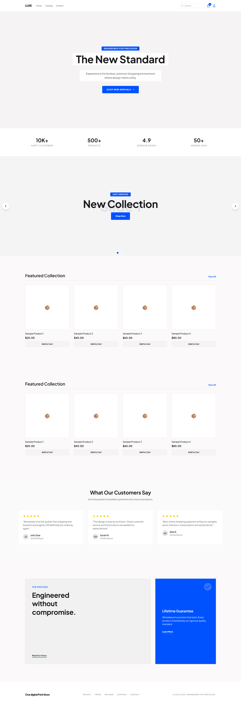

# vrenyaCart Theme Documentation

## Getting Started

\## Screenshot

1. **Install Theme**

   * Go to Shopify Admin > Online Store > Themes
   * Click "Add theme" > "Upload zip file"
   * Upload vrenyaCart-theme-v1.0.0.zip
2. **Activate Theme**

   * Click "Actions" > "Publish" on the theme

## Theme Settings

### Colors

* Primary: Main brand color
* Primary Hover: Color for button hovers
* Background: Page background
* Surface: Card backgrounds
* Text Primary/Secondary: Body text colors
* Border: Dividers and borders

### Typography

* Heading Font: For H1-H6
* Body Font: For paragraphs

### Social Media

* Facebook, Instagram, X, YouTube, Pinterest links

## Sections

### Header

* Style: Minimal, Classic, Centered
* Features: Search, Wishlist, Account, Language/Currency selector

### Homepage

* Hero Banner
* Feature Collection
* Products Grid
* Featured Blog
* Testimonials
* Newsletter

### Collections

* Product Grid
* Filters
* Sorting

### Product Page

* Gallery
* Info
* Form
* Content
* Related Products

### Additional Sections

* Trust Badges
* Upsell Popup
* Video Demo
* Store Locator
* Image Gallery
* FAQ
* Contact Form

## Customization

### Using Theme Editor

1. Go to Online Store > Customize
2. Select template to edit
3. Click sections to modify
4. Publish changes

### CSS Customization

Edit theme.css for custom styles.

## Support

**Email:** support@appixen.com
**Documentation:** https://appixen.com/shopify/docs

## Changelog

v1.0.0 - Initial release

